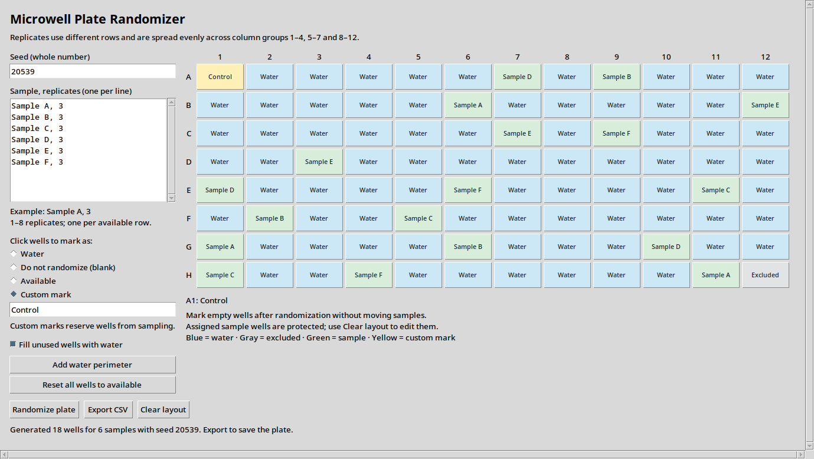

# Microwell Plate Randomizer

A lightweight desktop app for creating reproducible **96-well plate layouts**.
Edit sample names and replicate counts, add water, blank wells or custom marks, generate a
layout, and export it to a CSV file for Excel or other spreadsheet software.

**Made with AI assistance:** the app's code, tests and documentation were written
and revised with OpenAI Codex, based on an initial Python script and user requirements.



- Editable seed and per-sample replicate counts.
- Starts with all 96 wells available and generic Sample A–F examples.
- One-click water perimeter, custom well marks and optional water filling for unused wells.
- Edit empty wells after randomization without moving assigned samples.
- Replicates spread across three column groups, with no repeated row per sample.
- CSV export and clear explanations when a layout cannot be generated.
- Runs locally; no account, server, or third-party Python packages required.

## Quick start

You need **Python 3.10 or newer**, **Tkinter**, and a desktop display.
This download contains Python source, not a standalone executable. You do not
need Git, pip, or a virtual environment to run it directly.

1. On GitHub, select **Code → Download ZIP** (or download the source ZIP attached
   to a release).
2. **Extract the whole ZIP** to a folder. Keep the `microwell_plate_randomizer`
   folder next to `plate_randomizer_gui.py`.
3. Follow the instructions for your operating system below.

### Windows

Install a full Python distribution from [python.org](https://www.python.org/downloads/).
If using the traditional installer, leave **Tcl/Tk and IDLE** selected.

Double-click **`start_windows.bat`** in the extracted folder, or open a terminal
in that folder and run:

```powershell
py -3 plate_randomizer_gui.py
```

If `py` is unavailable but `python` works, use `python plate_randomizer_gui.py`.

### macOS

Install Python from [python.org](https://www.python.org/downloads/macos/);
its standard macOS installer includes Tkinter. Open Terminal in the extracted
folder and run:

```sh
python3 plate_randomizer_gui.py
```

Alternatively, run `sh start_mac_linux.command`. To enable double-click launching
from Finder, first run `chmod +x start_mac_linux.command` in that folder.

### Linux

Install Python and Tkinter using your distribution's package manager.

**Ubuntu / Debian:**

```sh
sudo apt update
sudo apt install python3 python3-tk
```

**Arch / CachyOS:**

```sh
sudo pacman -Syu python tk
```

Then open a terminal in the extracted folder and run:

```sh
python3 plate_randomizer_gui.py
```

You can also run `sh start_mac_linux.command`.

## Using the app

1. Set a whole-number **seed**. The default is `20539`.
2. Edit **Sample, replicates**: one sample per line, with the count after the last
   comma. Labels must be unique. Blank lines are ignored.

   ```text
   Sample A, 3
   Sample B, 2
   Sample C, 1
   ```

3. Select a well-editing mode, then click wells:

   | Mode | What happens |
   | --- | --- |
   | Water | The well is filled with water and cannot receive a sample. |
   | Do not randomize (blank) | The well stays empty; CSV exports it as `Unused`, even with automatic water filling enabled. |
   | Available | Removes water, exclusion or a custom mark and makes the well eligible for a sample. |
   | Custom mark | Enter text in the box (for example, `Positive control`), then click a well. It is reserved from sampling and exported with that text. |

4. Optionally click **Add water perimeter**, or check **Fill unused wells with water**
   to fill remaining unassigned wells after samples are placed. Custom marks and
   explicitly blank wells are preserved.
5. Click **Randomize plate**. Hover over a well, or focus it with the keyboard,
   to see its complete label below the plate.
6. Click **Export CSV** to save the layout. The CSV has a `Row` column and columns
   `1`–`12`, followed by eight rows (`A`–`H`). Water is exported as `Water`; empty
   and excluded wells are exported as `Unused`. Custom marks retain their full text.

### Editing a generated plate

You can add water or custom marks to empty wells, or leave them explicitly blank,
without clearing the layout or moving samples. You can also toggle automatic
water filling after generation. Water added automatically is not a reservation
for the next randomization; water you mark manually is.

Assigned sample wells are protected from accidental edits. Use **Clear layout**
to remove sample assignments before changing those wells. This keeps your manual
water, blank and custom selections. **Add water perimeter** also preserves any
existing samples, custom marks and explicitly blank wells on the edge.

**Reset all wells to available** clears the layout and all well marks, and turns
off automatic water filling. It keeps your seed, labels and replicate counts.
Changing the seed or sample list clears the generated layout. Clicking
**Randomize plate** again uses the current manual reservations and may move samples.

Settings are not saved between sessions. Keep your sample list, seed, selections
and app version alongside the exported CSV. The CSV records the final plate,
including manual edits made after randomization.

## Placement rules and limits

The app starts with **all 96 wells available**, without a water border. The optional
**Add water perimeter** button marks rows **A and H**, plus columns **1 and 12**.
Every well, including corners, can hold a sample, water, a custom mark or remain
blank. Available wells are not guaranteed to receive a sample; surplus wells
are `Unused`, or `Water` when automatic filling is enabled.

Sampling uses three column groups: **1–4**, **5–7**, and **8–12**. The outer groups
include the border columns; the existing interior group boundaries are preserved.
Version 1.2 changes the starting sample list and removes the automatic water border.
To recreate an older layout, restore its original sample list and well selections.

For each sample:

- The count must be **1–8** and cannot exceed the number of available rows.
  With a complete water perimeter, only six rows are available, so the maximum is six.
- Every replicate occupies a **different row**.
- Counts in the three column groups differ by at most one. Three replicates
  means one per group; five means a distribution of 2, 2, and 1.
- The program chooses which groups receive extra replicates based on the seed
  and well availability.

Excluding a well does **not** lock a previous sample into that well. There is no
fixed-sample placement feature. `Water` and `Unused` are reserved labels.
Custom marks do not count as sample replicates and cannot match sample names
or the status labels `Water`, `Unused`, `Available` or `Excluded` (case-insensitive).

A design may be impossible even when enough wells remain, because the row and
column-group rules also need to be satisfied. A bounded search stops difficult
requests and explains whether it found no valid layout or reached its search
limit. Reaching the limit does not prove a layout impossible: try another seed,
free more wells, or reduce replicate counts.

The algorithm is a seeded constraint search, **not uniform sampling of all valid
layouts**. Keep the same seed, sample order, labels, counts, water/excluded wells,
custom reservations, water-fill setting, app version and Python version to reproduce
a layout. Post-generation manual edits must also be repeated. The same seed alone is not
sufficient. Version 1.0 uses an updated algorithm and will not reproduce the
older prototype's exact layout.

## Troubleshooting

| Problem | What to do |
| --- | --- |
| `python` / `python3` / `py` not found | Install Python, reopen the terminal, and use the command shown for your OS above. |
| Missing `tkinter`, `_tkinter`, or `libtk` | Install Tk support for the Python interpreter you are running. Tkinter cannot be installed with `pip install tkinter`. |
| Cannot connect to display / no `$DISPLAY` | Run in a local desktop session. An ordinary headless server, SSH shell, or container has no GUI display. |
| `No module named microwell_plate_randomizer` | Extract the entire download; do not copy just the launcher. |
| GUI is wider than the screen | Use the horizontal and vertical scrollbars, or enlarge the window. |
| Label is shortened on a well | Hover over it or focus it with Tab to read the full label. The CSV keeps the full label. |
| Export button is disabled | Generate a plate using the current settings first. |
| Unable to save CSV | Choose a writable folder and close the file if it is open in another application. |

To check Python, Tkinter and the desktop display:

```sh
python3 plate_randomizer_gui.py --check
```

On Windows, substitute `py -3` for `python3`. The standard Tkinter diagnostic is
`python3 -m tkinter`, which opens a small test window.

Installation references: [Python Tkinter documentation](https://docs.python.org/3/library/tkinter.html),
[Python on Windows](https://docs.python.org/3/using/windows.html),
[Python's macOS Tk support](https://www.python.org/download/mac/tcltk/),
[Ubuntu's python3-tk package](https://packages.ubuntu.com/search?keywords=python3-tk),
and [Arch's tk package](https://archlinux.org/packages/extra/x86_64/tk/).

## Optional package installation

Directly running the downloaded source is the simplest option. If you prefer an
installed command, create and activate a virtual environment, then run from the
project folder:

```sh
python -m pip install .
plate-randomizer
```

Tkinter must still be installed separately if your Python distribution does not
include it. Installing from source may download the build tool, setuptools.
You can also launch with `python -m microwell_plate_randomizer`.

## Development

Run the tests from the project folder, without installing any test packages:

```sh
python3 -m unittest discover -s tests -v
```

Core tests work without Tkinter or a display. GUI tests automatically skip when
Tkinter or a display is unavailable. The GitHub Actions workflow runs core/startup
checks on Linux, Windows and macOS, and GUI tests with a virtual display on Linux.

See [CONTRIBUTING.md](CONTRIBUTING.md) for the code structure and development checks.
To build a clean source ZIP, run `python3 tools/build_source_archive.py`.
The archive is written to `dist/`.

## License

[MIT](LICENSE).
